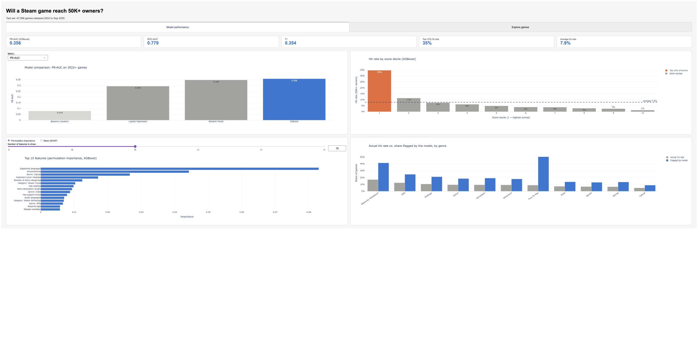
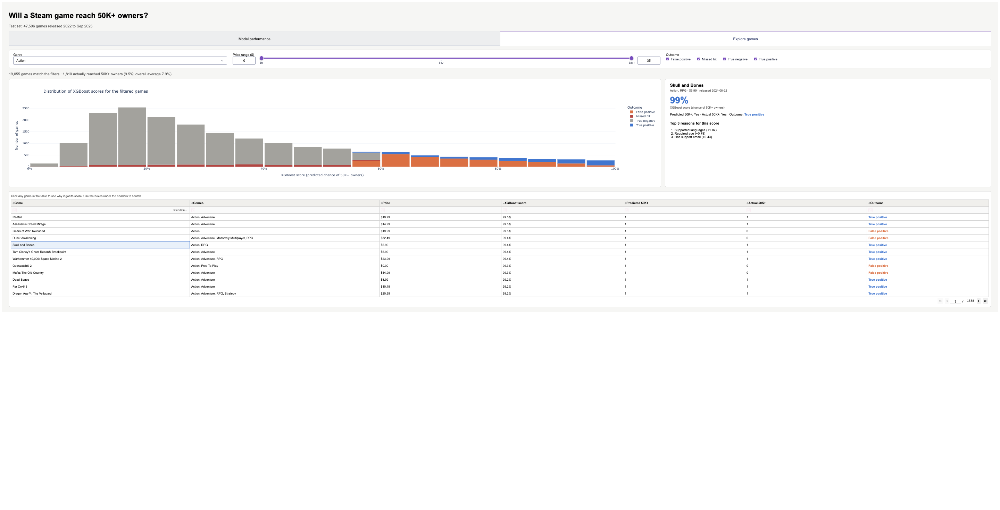

# Plotly Dash app: "What drives success"

An interactive dashboard on the XGBoost model that predicts whether a Steam game will reach 50K+ owners. It reads the ML outputs in `results/ml/`, so no other data files are needed.




## How to run

From the repo's main folder:

```
pip install -r dashboards/dash/requirements.txt
python dashboards/dash/app.py
```

Then open http://127.0.0.1:8050 in a browser.

## Tab 1: Model performance

- **KPI cards**: XGBoost PR-AUC, ROC-AUC, F1, top-10% hit rate, and the average hit rate (7.9%)
- **Model comparison**: pick a metric from the dropdown to compare the baseline, Logistic Regression, Random Forest and XGBoost
- **Lift by score decile**: the top 10% of scores reach 50K+ owners 35% of the time, about 4.4x the average
- **Feature importance**: switch between permutation importance and mean |SHAP|, and choose how many features to show with the slider
- **Genre**: actual hit rate vs. the share of games the model flags, by genre

## Tab 2: Explore games

- Filter the 47,596 test games (2022 to Sep 2025) by genre, price and outcome
- Score distribution, colored by outcome (true positive, false positive, true negative, missed hit)
- Searchable, sortable game table
- Click a game to see its score, actual vs. predicted result, and its top 3 SHAP reasons

## Files

| File | Contents |
|---|---|
| `app.py` | The Dash app (4 callbacks) |
| `requirements.txt` | Package versions |
| `dash_model_performance.png`, `dash_explore_games.png` | Screenshots |
