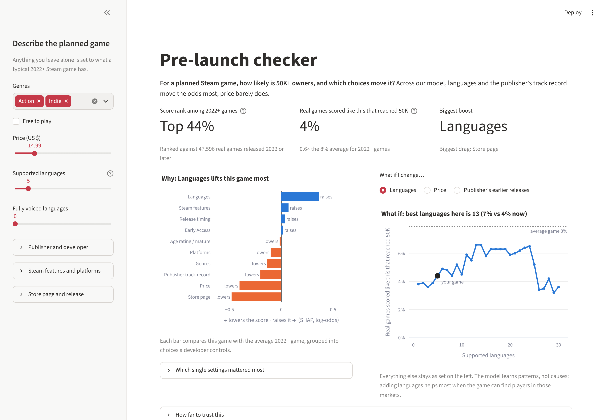

# Streamlit app: "Pre-launch checker"

**Question it answers:** for a game that has not launched yet, how does it rank against real Steam games, how often did similarly scored games reach 50K owners, and which choices would move it?

It uses the team's final XGBoost model (`results/ml/xgb_model.json`, from `notebooks/04_modeling.ipynb`). It complements the Plotly Dash app: Dash shows how good the model is across all games; this app applies it to **one planned game** with what-if changes.



## Run it (from the repo root)

```
pip install -r dashboards/streamlit/requirements.txt
streamlit run dashboards/streamlit/app.py
```

Opens at http://localhost:8501. On a Mac, XGBoost may also need `brew install libomp`.

## What is on the page

| Part | What it shows |
|---|---|
| Sidebar | The planned game: genres, price, languages; publisher, Steam features, store page in drop-downs. Anything not touched = a typical 2022+ game. |
| KPI 1: Score rank | Where the game's score falls among the 47,596 test games (2022+). |
| KPI 2: Real hit rate | Share of the 1,000 test games with the nearest scores that actually reached 50K. Used instead of the raw score, which class weighting inflates. |
| KPI 3: Biggest boost / drag | The lever group with the largest positive / negative SHAP value. |
| Why (SHAP) | Exact TreeSHAP values (`pred_contribs`) for this game, summed into 10 groups a developer controls. Blue raises, orange lowers. |
| What if | Re-scores the game across Languages, Price or Publisher's earlier releases; the title names the best value. |
| How far to trust this | Test-set metrics and caveats (Free to Play over-flagged after 2022). |

## Files

| File | What it is |
|---|---|
| `app.py` | The app. Reads `results/ml/` (model, features, metrics, test predictions). |
| `typical_values.json` | Defaults for untouched settings: median / majority of 2022+ games. |
| `build_typical_values.py` | Rebuilds that file from `steam_clean.csv` with the same feature steps as `04_modeling.ipynb`. |
| `screenshot.png` | For the README and report. |

Checked: rebuilding the 88 features from `steam_clean.csv` reproduces `prob_xgb` in `test_predictions.csv` for all 47,596 test games (largest difference 0.00005).

## Example: what moves one game

A first-time, self-published Action + Indie game at $14.99 with 5 languages, changed one step at a time:

| Change | Score rank | Similar games that hit 50K |
|---|---|---|
| Starting game | Top 44% | 4% (below the 8% average) |
| 5 → 13 languages | Top 35% | 7% |
| + website and support page | Top 16% | 10% |
| Publisher with 15 earlier releases | Top 8% | 19% |
| + Mac version | Top 7% | 21% (2.7× average) |

Price, by contrast: any paid price from $8 to $60 lands at 4–5% for the starting game. Only "free" scores higher, and the model over-flags free games after 2022.

Built by Keerat Khandpur.
